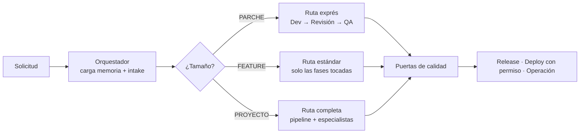
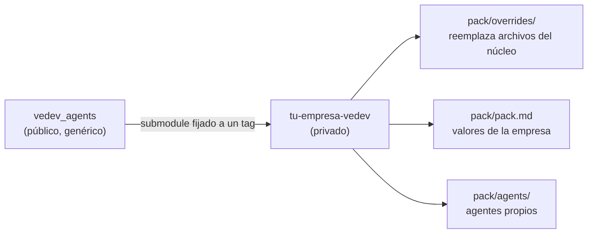

<div align="center">

# 🤖 vedev_agents

**Un equipo de ingeniería de software con IA, listo para usar.**

An AI software-engineering team in a box: 23 specialized agents (architect, UX/UI, devs, QA, cybersecurity, DevOps, DBA, BI…) that take any project from idea to production. Spec-driven, token-efficient, engine-agnostic — Claude Code, Cursor, Codex, OpenCode & more.


[Inicio rápido](#-inicio-rápido) · [Cómo funciona](#-cómo-funciona) · [El equipo](#-el-equipo) · [Instalación](#-instalación) · [Cumplimiento](#️-capa-de-cumplimiento) · [Packs de empresa](#-packs-de-empresa) · [Hoja de ruta](#️-hoja-de-ruta)

</div>

---

## ¿Por qué vedev_agents?

Los asistentes de IA programan rápido, pero sin proceso cada persona del equipo trabaja distinto: unos documentan, otros no; unos prueban, otros confían; las decisiones se pierden en el chat. Y los frameworks de agentes que sí imponen proceso suelen cobrar **la misma ceremonia por un bugfix que por un proyecto**, quemando tokens.

vedev_agents resuelve las dos cosas:

- 🧭 **Un proceso estándar de industria**, el mismo para todo el equipo: historias con criterios verificables, decisiones registradas, revisión independiente, pruebas desde la especificación, seguridad, versionado y documentación.
- ⚡ **Ceremonia proporcional al tamaño**: un parche usa 3 agentes, no 23.
- 🔌 **Portable**: Markdown puro. Funciona en Claude Code, Cursor, Codex, OpenCode, Warp y más.
- 🏢 **Personalizable sin forks**: lo propio de tu empresa vive en un *pack* aparte; el núcleo no se toca.
- 🛡️ **Reglas que se cumplen solas**: CI, protección de ramas, plantillas y hooks hacen cumplir lo verificable, use o no la gente los agentes.

---

## 🚀 Inicio rápido

**1. Instala** (ejemplo con Claude Code, en la raíz de tu proyecto):

```bash
git clone https://github.com/andresvd95/VeDev_agents.git .claude/skills/vedev_agents
```

> ¿Usas otro entorno? Mira la [tabla de instalación](#-instalación).

**2. Pide lo que necesitas**, en tu idioma:

```
Quiero construir una API de reservas para clínicas. Modo semiautomático.
```

**3. El Orquestador hace el intake**, clasifica la tarea, te dice qué agentes activa (y cuáles no, y por qué) y arranca. Al cerrar cada fase recibes un reporte como este:

```
## Arquitectura — requiere decisión
Ruta: PROYECTO · Modo: 🤝 Semiautomático
Qué se hizo: TDD con diagramas C4 y modelo de datos. Falta elegir la base de datos.
Artefactos: docs/tdd.md, docs/adr/ADR-001-borrador.md
Puerta de calidad: pendiente — decisión mayor sin elegir
Decisiones pendientes: base de datos (3 opciones, recomendada: PostgreSQL)
Consumo de la fase: ~18K tokens (estimado) · 12% del presupuesto
Siguiente paso: elige una opción para continuar con Diseño UX/UI
```

*(Ejemplo ilustrativo del formato de reporte.)*

---

## 🧠 Cómo funciona



### Tres rutas según el tamaño

| Ruta | Cuándo | Qué se produce | Agentes típicos |
|---|---|---|---|
| ⚡ **PARCHE** | Fix puntual o cambio menor | Historia mínima, código, prueba del caso | Dev + Reviewer + QA |
| 🧩 **FEATURE** | Funcionalidad nueva acotada | Historias, diseño de la parte afectada, pantallas, pruebas, docs | Solo los de las fases que toca |
| 🏗️ **PROYECTO** | Nuevo, escalamiento o refactor mayor | Viabilidad, PRD, TDD, ADR, tokens de diseño, código, pruebas, seguridad, docs, deploy | Núcleo + especialistas que indique la matriz |

> **Regla de oro:** un bugfix nunca paga el peaje de un proyecto.

### Ajustes para proyectos pequeños

En FEATURE y PROYECTO, el Orquestador **pregunta** (nunca decide solo) si quieres reducir u omitir entregables negociables, con una recomendación por punto. Por ejemplo: 2–3 historias en vez del set completo, sin PRD, decisiones en una lista en vez de ADR, o sin rama `develop`. Lo no negociable se mantiene siempre: criterios de aceptación, revisión independiente, pruebas, sin secretos, nada directo a `main`, deploy con permiso. 👉 [protocols/ceremony-options.md](protocols/ceremony-options.md)

### El pipeline completo

`Viabilidad → Requerimientos → Arquitectura → Diseño UX/UI → Construcción → Revisión → QA → Seguridad → Documentación → Deploy → Operación`

Los proyectos existentes **entran en la fase que corresponda**: un mantenimiento entra directo en Construcción; una auditoría solo produce un informe.

### Principios que no se negocian

| Principio | En la práctica |
|---|---|
| 💬 **Artefactos, no chat** | Los agentes se pasan documentos con plantilla, nunca el historial de la conversación |
| 🎯 **Activación mínima** | Ningún agente entra "por si acaso"; los especialistas solo si la matriz de cobertura lo justifica |
| 🔁 **Topes duros** | Máximo 3–5 iteraciones por bucle; al tope, se detiene y te da opciones |
| 🧪 **Pruebas desde la especificación** | QA escribe los tests desde los criterios de aceptación *antes* de ver el código, y el Reviewer lo verifica |
| ⚖️ **Tú decides lo importante** | Decisiones mayores con máximo 3 opciones y una recomendada; la elección queda en un ADR |
| 🔐 **Seguro por defecto** | Sin secretos de producción, sin commits directos a `main`, sin deploy a producción sin tu permiso |
| 🧠 **Memoria del proyecto** | `project-state.md` guarda dónde va todo; cada sesión arranca con un resumen de 5 líneas |

### Modos de autonomía

| Modo | Comportamiento |
|---|---|
| 🚀 **Piloto automático** | Avanza solo; se detiene en decisiones mayores, versión MAJOR, deploy a producción o bloqueos |
| 🤝 **Semiautomático** *(por defecto)* | Como el anterior, y además confirma deploys y cambios de alto impacto |
| 🧭 **Guiado** | Confirma contigo al cerrar cada fase |
| 🔍 **Auditoría** | Solo lectura: entrega un informe priorizado sin tocar nada |

---

## 👥 El equipo

### Piso 1 — Núcleo (16 agentes)

| Agente | Qué hace | Piso de modelo |
|---|---|---|
| [Orquestador](agents/orchestrator.md) | Tech Lead: intake, ruta, convoca agentes, custodia la memoria. No escribe código | Fuerte / estándar |
| [Analista de viabilidad](agents/feasibility-analyst.md) | ¿Vale la pena? Construir, comprar o reutilizar | Estándar |
| [Analista de requerimientos](agents/requirements-analyst.md) | Historias con criterios Dado/Cuando/Entonces, MoSCoW, PRD | Estándar |
| [Arquitecto](agents/architect.md) | TDD, diagramas C4/UML, stack, regla de 3 opciones, ADR | Fuerte |
| [Repo Scout](agents/repo-scout.md) | Busca lo que ya existe antes de construir. Solo recomienda | Económico |
| [Diseñador UX/UI](agents/ux-ui-designer.md) | Flujos, pantallas con estados, WCAG 2.2 AA, design tokens, Figma | Estándar |
| [Dev Backend](agents/dev-backend.md) | Lógica de servidor, APIs, integraciones | Estándar |
| [Dev Frontend](agents/dev-frontend.md) | Interfaces 100% basadas en tokens, responsive y accesibles | Estándar |
| [Dev Data](agents/dev-data.md) | Esquemas, migraciones reversibles, consultas | Estándar |
| [Git & Release Manager](agents/git-release-manager.md) | Ramas, commits convencionales, SemVer, releases | Económico |
| [Code Reviewer](agents/code-reviewer.md) | Revisión independiente con hallazgos `archivo:línea` | Fuerte |
| [QA Engineer](agents/qa-engineer.md) | Pruebas derivadas de la especificación, suites rápida y completa | Estándar |
| [Ciberseguridad](agents/cybersecurity-engineer.md) | STRIDE, OWASP Top 10, secretos, privacidad y cumplimiento | Fuerte |
| [Documentador](agents/documenter.md) | README, API, runbook, changelog, postmortems | Estándar |
| [DevOps / Deploy](agents/devops-deploy.md) | CI/CD, guía de despliegue, rollback. Producción solo con permiso | Estándar |
| [El Centinela](agents/sentinel.md) | Presupuesto de tokens, backups verificados, salud, incidentes | Económico |

### Piso 2 — Especialistas bajo demanda (7 agentes)

En reposo no consumen contexto. Se activan solo si la [matriz de cobertura](protocols/coverage-matrix.md) lo indica, y el Orquestador te dice por qué.

| Especialista | Se activa cuando… |
|---|---|
| [DBA / Arquitecto de datos](agents/specialists/dba-data-architect.md) | Hay base de datos propia, volumen serio o migraciones |
| [BI y dashboards](agents/specialists/bi-dashboards.md) | El negocio pide reportes o tableros de decisión |
| [Contenedores](agents/specialists/containers-specialist.md) | El despliegue es contenerizado o multiservicio |
| [Arquitecto cloud](agents/specialists/cloud-architect.md) | Nube nueva, migración o costos que gobernar |
| [Infra, redes y SRE](agents/specialists/infra-networks-sre.md) | Infraestructura propia o red no trivial |
| [Rendimiento](agents/specialists/performance-engineer.md) | Hay requisitos de carga o latencia, o lentitud reportada |
| [IA de producto](agents/specialists/ai-product-engineer.md) | El producto tiene una capa de IA activa (no una idea futura) |

---

## 📦 Instalación

Cada entorno se instala en **un solo paso**. El detalle (activación, MCP, limitaciones) está en cada adaptador.

| Entorno | Paso único | Guía |
|---|---|---|
| **Claude Code** | `git clone https://github.com/andresvd95/VeDev_agents.git .claude/skills/vedev_agents` | [claude-code.md](adapters/claude-code.md) |
| **Cursor** | Comando único: clona + una línea en `AGENTS.md` (abajo) | [cursor.md](adapters/cursor.md) |
| **Codex** | Comando único: clona + una línea en `AGENTS.md` (abajo) | [codex.md](adapters/codex.md) |
| **OpenCode** | Comando único: clona + una línea en `AGENTS.md` (abajo) | [opencode.md](adapters/opencode.md) |
| **Warp** | Comando único: clona + una línea en `AGENTS.md` (abajo) | [warp.md](adapters/warp.md) |
| **Hermes** | `git clone https://github.com/andresvd95/VeDev_agents.git ~/.hermes/skills/vedev_agents` | [hermes.md](adapters/hermes.md) · *por verificar* |
| **Orca** | Comando único con el archivo de instrucciones del proyecto | [orca.md](adapters/orca.md) · *por verificar* |

Comando único para entornos basados en `AGENTS.md` (Cursor, Codex, OpenCode, Warp):

```bash
git clone https://github.com/andresvd95/VeDev_agents.git vedev_agents && printf '\n## vedev_agents\nSigue vedev_agents/SKILL.md como protocolo de trabajo. Agentes en vedev_agents/agents/.\n' >> AGENTS.md
```

> **¿Tu entorno no tiene subagentes?** No pasa nada: un solo agente ejecuta los roles en secuencia leyendo los mismos archivos.

---

## 🛡️ Capa de cumplimiento

Los protocolos dicen qué reglas sigue el equipo; la capa de cumplimiento hace que **el repositorio no deje romperlas**. Se aplica a tu proyecto en un paso (Git Bash en Windows):

```bash
sh .claude/skills/vedev_agents/enforcement/apply.sh
```

| Qué instala | Qué hace cumplir |
|---|---|
| CI (`vedev-ci`) | Título de PR con commits convencionales · escaneo de secretos · sin `.env` reales · pruebas |
| Plantillas de PR e issues | Definición de Terminado en cada PR · historias con criterios Dado/Cuando/Entonces |
| Hooks de git | Sin commits directos a `main`/`develop` · commits convencionales · sin `.env` en el commit |
| Protección de ramas (un comando `gh`) | Solo por PR, con aprobación y checks obligatorios, sin force-push |

GitHub y GitLab soportados. No borra nada y conserva los archivos que ya tengas. 👉 [enforcement/README.md](enforcement/README.md)

## 🧩 Funciona con otras herramientas

vedev es la **capa de proceso**; no compite con los paquetes de skills y agentes que ya uses, los aprovecha. Si en tu entorno hay, por ejemplo, revisores especializados por lenguaje (como los de *Everything Claude Code*) o flujos de TDD y depuración (como los de *Superpowers*), los agentes de vedev pueden delegarles el "cómo" de su paso, manteniendo los artefactos, las puertas y las reglas duras de vedev. Nada externo es obligatorio. 👉 [protocols/interop.md](protocols/interop.md)

---

## 🏢 Packs de empresa

El núcleo es genérico a propósito. Lo particular de tu empresa (regulación, stack oficial, nombres de ramas, gestor de secretos, canal de alertas, plantillas con tu formato, agentes extra) va en un **pack**, idealmente en un repositorio privado:



- El pack **sobrescribe**, nunca edita el núcleo.
- Tu empresa fija una versión del núcleo y actualiza cuando quiere.
- Lo que sirve a todos se propone al núcleo.

👉 Guía completa: [packs/README.md](packs/README.md)

---

## 👩‍💻 Para equipos humanos

El proceso también está escrito **para personas, sin IA**: [docs/proceso-equipo.md](docs/proceso-equipo.md) (10 minutos de lectura). Incluye Definición de Listo y de Terminado, flujo de ramas, checklist de PR, versionado y qué configurar en el repositorio para que las reglas se cumplan solas.

Así todo el equipo habla el mismo idioma, use o no los agentes.

---

## 🗂️ Estructura del repositorio

```
SKILL.md          Protocolo del Orquestador (lo que carga el entorno)
agents/           16 agentes del núcleo
  specialists/    7 especialistas bajo demanda
protocols/        intake · autonomía · cobertura · 3 opciones · memoria · git/semver · .env
                  · design tokens · integraciones · economía de tokens · puertas de calidad
                  · cumplimiento · interoperabilidad · piloto · ajustes de ceremonia
templates/        PRD · TDD · ADR · historia · estado del proyecto · seguridad · deploy · release
                  · auditoría · informe de piloto
enforcement/      CI, plantillas de PR/issues, hooks y protección de ramas + apply.sh
adapters/         instalación y activación por entorno
packs/            cómo personalizar para una empresa sin tocar el núcleo
docs/             guía del proceso para personas
```

---

## 🛣️ Hoja de ruta

- [x] **v0.1.0** — Especificación completa: orquestador, 23 agentes, protocolos, plantillas, adaptadores
- [x] **v0.2.0** — Capa de cumplimiento (CI, plantillas, hooks, protección de ramas), interoperabilidad y protocolo de piloto
- [ ] **v0.3.0** — Piloto ejecutado en proyectos reales (un parche, una feature, un proyecto) con informe publicado
- [ ] **v0.4.0** — Adaptadores validados en cada entorno (incluye Orca y Hermes)
- [ ] **v1.0.0** — Estable, con benchmark publicado

## ⚠️ Estado y limitaciones

Lo decimos claro: **v0.2.0 sigue sin piloto.** El protocolo para medirlo ya está en [protocols/pilot.md](protocols/pilot.md).

- La eficiencia de tokens está diseñada pero **aún no medida**.
- La capa de cumplimiento se probó localmente (hooks e instalador), pero el CI aún no se ha ejecutado en un repositorio real.
- El Centinela define políticas y verifica; el monitoreo continuo y los backups programados los ejecutan herramientas reales (CI, nube, monitoreo).
- El consumo de tokens se reporta cuando el entorno lo expone; si no, se estima y se marca como estimación.
- Los adaptadores de Orca y Hermes están por verificar.

¿Lo probaste? Abre un issue con tu experiencia: es la forma más rápida de llegar a v1.0.

---

## 🤝 Contribuir

- **Issues:** errores, ideas o resultados de pilotos.
- **Pull requests:** mejoras al núcleo. Si algo nació en un pack y sirve a cualquier equipo, súbelo aquí.
- Mantén el formato: cada agente con sus 8 secciones, núcleo agnóstico (sin empresas reales), todo en español.

## 📄 Licencia

[MIT](LICENSE) © 2026 andresvd95
