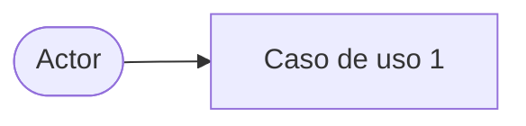
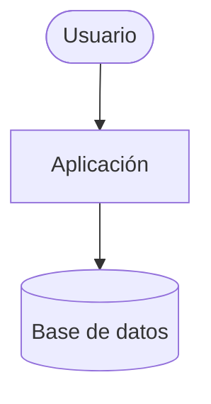
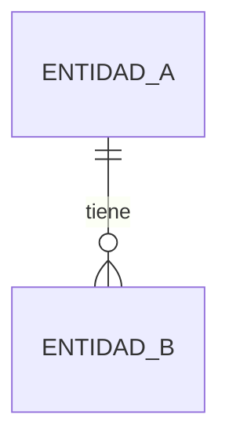

# TDD — [Nombre del sistema]

> Documento de diseño técnico. Dueño: `architect`.

**Versión:** [x.y] · **Fecha:** [AAAA-MM-DD] · **PRD relacionado:** [enlace]

## 1. Resumen
[3–5 líneas: qué se construye y el enfoque técnico elegido]

## 2. Actores y casos de uso

## 3. Contexto y contenedores (C4)

## 4. Componentes y capas
- **Arquitectura de referencia:** [p. ej. Clean Architecture: dominio · casos de uso · adaptadores · infraestructura]
- **Componentes:** [nombre — responsabilidad — capa]

## 5. Modelo de datos (alto nivel)

## 6. Contratos (API / eventos)
| Método | Ruta / evento | Entrada | Salida | Errores |
|---|---|---|---|---|
| [GET] | [/recurso] | [ … ] | [ … ] | [ … ] |

## 7. Stack y decisiones
| Área | Elección | ADR |
|---|---|---|
| [lenguaje/framework/BD/nube] | [ … ] | [ADR-00X] |

## 8. Seguridad
- Modelo de amenazas (STRIDE): [enlace o resumen]
- Autenticación y autorización: [ … ]

## 9. Requisitos no funcionales y cómo se cumplen
| Requisito | Estrategia |
|---|---|
| [ … ] | [ … ] |

## 10. Riesgos técnicos y preguntas abiertas
- [ … ]
